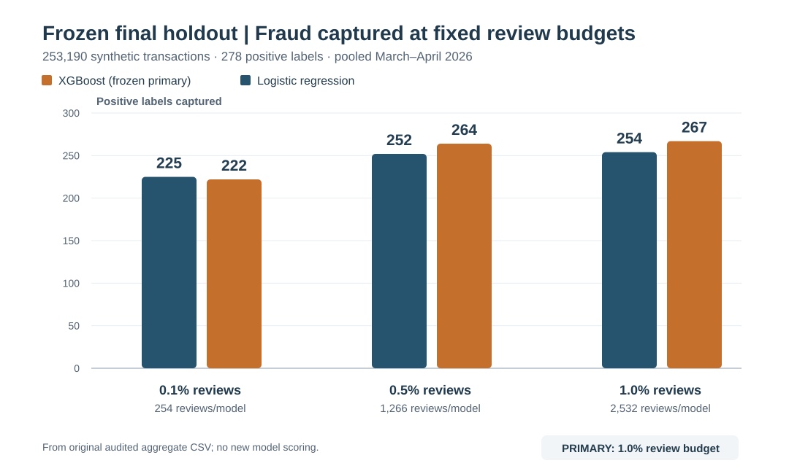
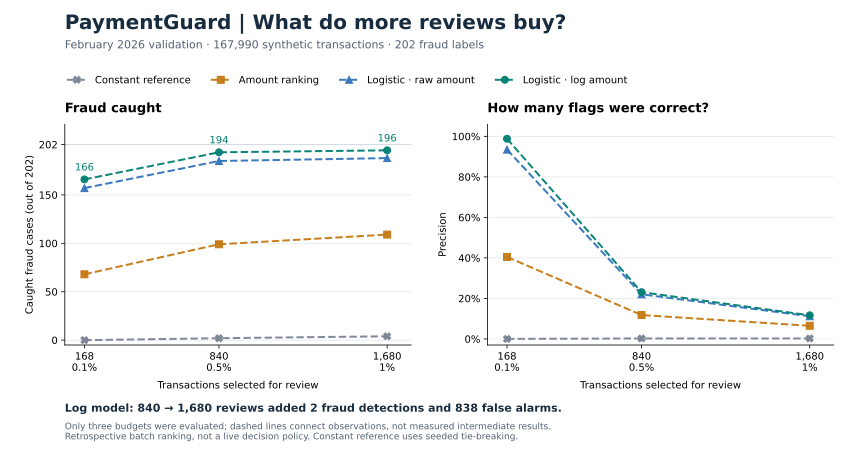
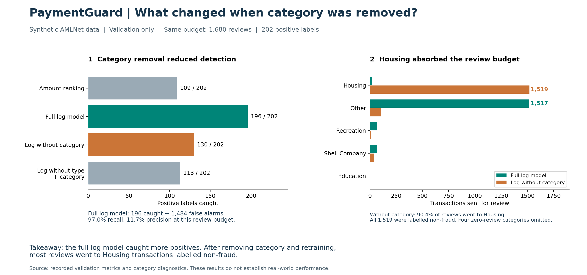
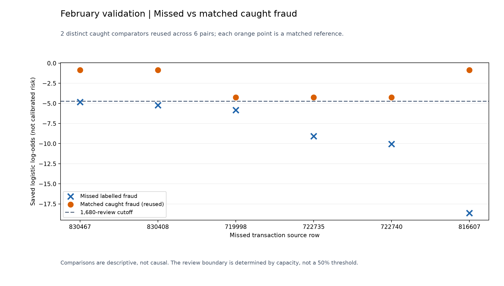
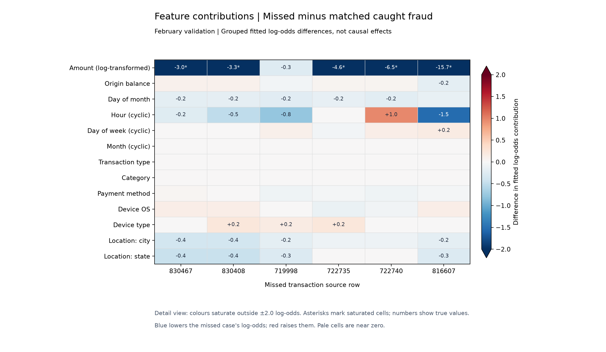
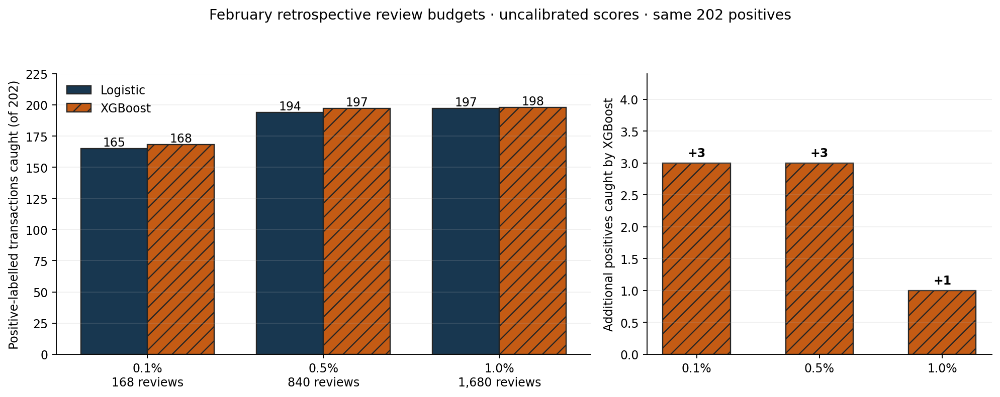
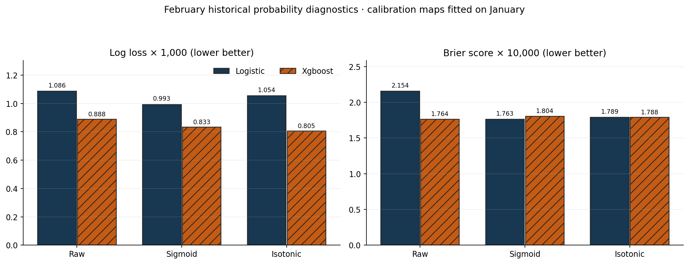
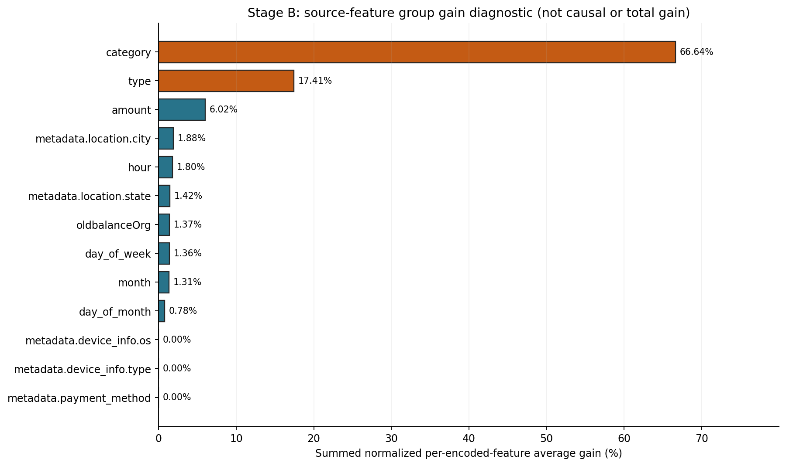

# PaymentGuard

I am studying how to rank payment transactions for fraud review when only a small share can be checked. I started with data validation and SQL exploration, then compared two logistic regression baselines with simple reference rankings.

**Current milestone: I completed one frozen March–April 2026 holdout comparison of XGBoost and logistic regression, then published the verified aggregates, sensitivity analysis and paired-disagreement results.** This is an independent portfolio research project using synthetic AMLNet v2 data. It is not a deployed fraud-detection service or affiliated with a commercial product of the same name.

## Frozen final holdout (March–April 2026)

The primary model and **1% review budget** were fixed in a written protocol **before scoring**. I compared the saved full-feature, uncalibrated XGBoost and logistic models on **253,190 synthetic transactions** containing **278 positive labels**, using **2,532 reviews per model**.

| Primary pooled result (1% capacity) | XGBoost | Logistic |
| --- | ---: | ---: |
| Positive labels captured | **267** | 254 |
| Recall | **96.04%** | 91.37% |
| Precision among reviews | **10.55%** | 10.03% |
| Average precision (whole ranking) | **0.8934** | 0.8686 |

The **+13** positive-label advantage for XGBoost is the outcome of the frozen primary comparison. It is **not** an accuracy figure, proof of statistical superiority, or evidence of real-world deployment suitability. At the smaller **0.1%** review capacity logistic catches **225** positives versus XGBoost's **222**. At 1%, both catch **252 of the same positive labels**, but their full review lists share only **1,210 of 2,532 rows**.



**Feature dependence is a major limitation:** without `category`, XGBoost catches **169** positive labels at 1%; without both `category` and `type`, it catches **141**. Those synthetic fields have **unverified decision-time provenance in real applications**, and the AP measure favours logistic regression within the two reduced-feature variants.

The complete [final research interpretation](docs/final_holdout_first_results.md) includes monthly breakdowns, the conflicting smallest-budget result, probability calibration diagnostics, and all limitations. The [frozen protocol](docs/final_holdout_frozen_protocol.md), [first-run instructions](docs/final_holdout_execution.md), [42 audited metric records](results/tables/final_holdout_v1/metrics.csv), [9 paired comparisons](results/tables/final_holdout_v1/paired_overlap.csv) and [public arithmetic/checksum verifier](scripts/audit_final_holdout_public.py) document what was actually tested. The original fitted models, holdout scores and transaction records remain **local and excluded from Git**. The first completed run passed a read-only hash/metric audit. An earlier command loaded but did not score the holdout due to a Python import-path error; I documented that interruption instead of calling these rows wholly unseen.

## Earlier February baseline result

I trained on 668,820 earlier transactions and evaluated on 167,990 transactions from February 2026, including 202 positive labels. At the predeclared 1% review budget, each approach flagged exactly 1,680 transactions.

| Approach | Fraud labels caught | False alarms | Precision | Recall |
| --- | ---: | ---: | ---: | ---: |
| Constant training prevalence | 4 | 1,676 | 0.24% | 1.98% |
| Largest amounts first | 109 | 1,571 | 6.49% | 53.96% |
| Logistic regression: raw amount | 188 | 1,492 | 11.19% | 93.07% |
| Logistic regression: log amount | 196 | 1,484 | 11.67% | 97.03% |

The log-amount model caught 196 of 202 fraud labels, but most of its flags were false alarms. **97.03% is recall, not accuracy or the percentage of flags that were correct.** The constant reference has identical scores for every transaction; its result comes from one fixed, label-independent random tie order.



At 840 reviews, the log model caught 194 positives. Doubling the workload to 1,680 added two positives and 838 false alarms. That trade-off is why I want to study review costs before choosing a decision policy. It does not establish an optimal budget.

The [results account](docs/logistic_baseline_first_results.md) includes all three declared budgets, average precision, probability losses, convergence records and limitations. These results came from my local run at commit `28f1de7`. The committed [aggregate counts](results/tables/logistic_baseline_review_counts.csv) were transcribed from its printed metrics; model files and row-level predictions remain local. I later verified the saved local artifacts and reconstructed predictions using a separate audit, described below.

## What the category investigation showed



At the same 1,680-review budget, removing category and refitting the log model
reduced caught positives from 196 to 130. Housing then used 1,519 reviews, all
labelled non-fraud. This helped me see where review capacity went, rather than
looking only at the overall recall. The full model still produced 1,484 false
alarms; its stronger recall did not make most alerts correct.

I also reconstructed two Housing predictions around the cutoff from their
transformed inputs, fitted coefficients and intercept. Their probabilities
were almost identical, but the review budget selected rank 1,680 and excluded
rank 1,681. The [visual guide](docs/visual_results_guide.md) explains both
figures, including the separate technical score breakdown, its equations and
limitations. The [score analysis](docs/housing_score_contributions.md) records
the local checks and the [category error account](docs/validation_category_errors.md)
provides the wider breakdown.

## What I built

- **Verified data preparation:** audited 1,090,000 synthetic transactions and reconciled 1,411 positive labels; preserved source references and assigned chronological splits.
- **Leakage review:** examined nested metadata and excluded supplied risk scores, duplicate targets, post-transaction balances and annotations that reveal the target.
- **SQLite and SQL analysis:** checked the imported table against every prepared value, then explored training-period amounts, transaction types, transfers and monthly fraud rates.
- **Baseline experiment:** compared raw and log-transformed amounts using the same logistic model settings, plus constant-prevalence and amount-ranking references.
- **Reproducible evaluation:** saved local model artifacts, predictions, dependency versions, hashes and convergence records; published aggregate results and a plotting script. At that checkpoint, the expanded suite had 141 passing tests on my Mac. The later frozen evaluation checkpoint passed 184 tests; the public audit tests added after the run require a new local check.

## Why this comparison

I chose logistic regression as a first interpretable fitted baseline. It lets me examine whether the permitted transaction features improve ranking beyond simply reviewing the largest amounts. Changing only the amount transformation gives me a specific comparison to investigate before adding a more complex model.

Both fits use L2 regularization and the same 13 source predictors. Scaling and categorical encoding are fitted on training rows only. Calendar cycles use fixed sine/cosine features. The [experiment plan](docs/baseline_experiment_plan.md), written before the run, explains the mathematical reasoning, feature choices and review budgets.

| Period | Transactions | Positive labels | Role |
| --- | ---: | ---: | --- |
| Before February 2026 | 668,820 | 931 | Fit preprocessing and models |
| February 2026 | 167,990 | 202 | Compare baseline rankings |
| March–April 2026 | 253,190 | 278 | Final out-of-time holdout; scored once under frozen protocol |

The historical training commands read and score only training/validation periods. The separate frozen final evaluation has now scored March–April once. Earlier exploratory auditing did examine the full dataset, so this is a chronological holdout after auditing, not an entirely unseen dataset.

## Saved-run verification and six missed cases

I added a read-only audit for the two local logistic experiments. On my Mac,
the audit verified the saved manifests, artifact hashes, fitted models,
validation predictions and reported confusion counts for the four original
baseline approaches (two fitted models and two references) and ten
feature-ablation approaches (eight fitted models and two references). It reconciled all
42 published aggregate result rows. Both runs covered the same 167,990
February validation transactions. The full 94-test suite passed locally.

The audit is stronger evidence of internal reproducibility, but the model
files, prepared data and row-level predictions remain local. Readers cannot
independently repeat the full saved-run audit from a public clone alone.
See the [verification notes](docs/verification_checkpoint.md).

For the full log-amount model at 1,680 review slots, 196 of 202 positive
validation labels were selected, leaving six outside the review set. Their
combined transaction amount was 5,052.04 dataset units; **this is not a
measured financial loss**. I reconstructed fitted logistic log-odds for these
six cases and compared them with detected positives having the same transaction
type and category. The six comparisons reused **two distinct detected cases**,
so they describe individual predictions rather than a representative or
causal sample. At that earlier validation checkpoint, the March–April holdout had not been scored; its later frozen result is documented above.





The detailed heatmap clips the **display colour range only**, at ±2 log-odds
units, and marks out-of-range cells. The underlying numerical differences are
not clipped. The [full-range heatmap](results/figures/missed_fraud_feature_differences_diverging_full.png)
shows the absolute magnitude of the extreme cases. My
[case analysis](docs/missed_fraud_contribution_study.md),
[figure notes](docs/missed_fraud_visualization_revision.md) and
[comparison tables](results/tables/missed_fraud_matched_pairs.csv) record the
calculations and their limitations. Amount often explains much of a score gap,
but these fitted contributions do not establish causes of fraud.

## Chronological probability calibration and reliability

After checking the original logistic ranking and its six missed cases, I tested
whether the scores behave reliably as probabilities. This was a separate,
forward-only historical experiment, not a new fraud-detection service or a
claim of improved real-world performance.

I fitted a log-amount logistic model on October–November 2025, fitted
calibration mappings on December and chose a method using January 2026.
**Isotonic regression was selected on January log loss.** I then refitted
the base model on October–December, calibrated on January and reported the
February results without changing that choice.

At the predeclared **1% February review budget (1,680 transactions)**, all
three versions caught **197 of 202** fraud-labelled transactions, with
**1,483 false alerts**. The February probability results were:

| Calibration | Log loss (lower is better) | Brier score (lower is better) | Caught at 1% |
| --- | ---: | ---: | ---: |
| Uncalibrated | 0.001086 | 0.000215 | 197 |
| Sigmoid | **0.000993** | **0.000176** | 197 |
| Isotonic (January-selected) | 0.001054 | 0.000179 | 197 |

Sigmoid had lower February probability losses, although January selected
isotonic. This difference is a reason to investigate temporal stability,
**not** a reason to retroactively switch the selected method. In this
experiment calibration did not increase fraud capture at fixed review
capacity. The earlier October–January baseline caught 196, but its different
fitting window prevents attributing the one-case difference to calibration.


I revised the plots to compare the three methods on **identical, fixed
uncalibrated-score deciles** instead of potentially different quantile bins.
The [January figure](results/figures/calibration_january_shared_deciles.png)
and [predicted-versus-observed views](docs/calibration_first_results.md#corrected-visual-comparison)
provide the complementary interpretation. The complete
[calibration findings](docs/calibration_first_results.md),
[pre-run protocol](docs/calibration_temporal_protocol.md),
[visualization notes](docs/calibration_visualization_revision.md) and
[saved-run verification](docs/calibration_saved_run_verification.md)
explain the equations, controls and limitations. The local v2 audit reloaded
six fitted objects and reconstructed their results; **124 tests passed locally**
after the publication checks. Models, predictions and prepared data remain
outside Git. January and February were historical research periods; the separate March–April holdout was subsequently scored once under the committed freeze.

## Chronological nonlinear benchmark: XGBoost

I added XGBoost as a controlled nonlinear comparison rather than replacing
my verified logistic regression baseline. I retained the same 13 source
predictors and review budgets, while allowing boosted trees to model
nonlinear relationships and feature interactions.

I fitted three predefined XGBoost configurations on October–November 2025.
December average precision selected depth 3 with 240 boosting rounds
(AP 0.890792). The next-best candidate had AP 0.887980. These are
development results, not evidence that the selected configuration is
universally better.

In January, with both model families fitted on October–November, the
uncalibrated logistic and XGBoost models each caught 271 of 281 positive
labels at 1% reviews. Their average precision values were 0.926641 and
0.927030, respectively.

For February, I compared a newly fitted October–December XGBoost model,
calibrated on January where appropriate, with the verified logistic
Stage-B comparison using the same fitting period. At identical review
budgets, the uncalibrated results were:

| February review budget | Logistic positives caught | XGBoost positives caught |
| --- | ---: | ---: |
| 0.1% (168 reviews) | 165 | 168 |
| 0.5% (840 reviews) | 194 | 197 |
| 1.0% (1,680 reviews) | 197 | 198 |

There were 202 positive labels in February. At the 1% budget, XGBoost
caught one more positive, but its 1,680 reviews still included 1,482
negative-labelled transactions. Uncalibrated average precision was
0.941444 for logistic regression and 0.947867 for XGBoost; log loss
was 0.001086 and 0.000888, respectively.

I also tested sigmoid and isotonic probability calibration for XGBoost.
Isotonic produced the lowest observed February XGBoost log loss
(0.000805), but its average precision (0.935069) was below the
uncalibrated model (0.947867). I did not select a final calibration
method by looking at February.





The XGBoost model's grouped feature-importance analysis assigned
66.64% of the summed normalized average-split-gain values to category
and 17.41% to transaction type. These numbers are not causal
contributions or shares of total model gain. They motivate a
chronological feature-ablation experiment rather than proving leakage.



The [complete XGBoost results and mathematical interpretation](docs/xgboost_first_aggregate_results.md),
[chronological protocol](docs/xgboost_chronological_protocol.md),
[reproducibility instructions](docs/xgboost_run_instructions.md), and
[aggregate visualization audit](docs/xgboost_aggregate_review_install.md)
describe the algorithms, equations, verification, references and limits.
The [December comparison](results/figures/xgboost_benchmark_v1/xgb_december_candidate_comparison.png)
and [shared-cohort reliability figure](results/figures/xgboost_benchmark_v1/xgb_february_shared_cohort_split_scale.png)
provide additional diagnostics.

My local XGBoost and aggregate-review verification expanded the test
suite to 141 passing tests. February had already been explored in earlier
work and is not an untouched final test. No statistical superiority or
production performance is established by the February benchmark. The later frozen March–April evaluation is reported at the top of this README; fitted models and transaction-level predictions stay local.

## Limits and next questions

The data are fully synthetic. Strong scores may reflect how the dataset was generated; they do not establish performance on real payments. In particular, transaction type and category showed unusually strong label patterns. The completed [feature-removal comparison](docs/feature_ablation_results.md) showed substantial dependence on category: at 1,680 reviews, the log model caught 196 positives with all features, 193 without type, 130 without category and 113 without both. Amount ranking caught 109. This is dependence in a synthetic-data validation experiment, not proof of leakage. Device and location features also rely on an explicit assumption that they are available before authorization.

The original ranking evaluation uses an entire February batch retrospectively; it does not implement a live threshold or measure financial savings. My later historical calibration experiment compares probability reliability, but does not establish production-ready calibrated probabilities. The three review budgets were experiment choices, not measured business capacity. A new read-only local audit has checked artifact hashes, fitted-model predictions and reported counts for both saved experiments. This was verified on my machine, not by an external reproduction using independently acquired data. Earlier Housing score reconstructions remain illustrative individual checks.

I examined training category patterns and validation errors, then reconstructed two Housing scores around the review cutoff. I subsequently examined hypothetical review costs, cost-ratio sensitivity, fraud-labelled transaction-value capture and six missed positives. I have since reconstructed individual fitted contributions for the six misses. The logistic calibration study, XGBoost benchmark, paired model-disagreement analysis, category/type ablations and single frozen final holdout evaluation are complete. Formal statistical uncertainty quantification, real-world source-feature provenance verification and a measured capacity-aware policy remain future work. A dashboard is optional, not part of this completed milestone.

## Reproduce or inspect

From a cloned repository, create the project environment and run the tests:

```bash
conda env create --file environment.yml
conda activate payment-guard
PYTHONPATH=src python -m pytest -q
```

The tests use small fixtures and do not require downloading the full dataset. To regenerate the comparison figure from the committed aggregate counts:

```bash
PYTHONPATH=src python -m payment_guard.plot_logistic_baseline
```

For a full training run, follow the [dataset source and download instructions](data/raw/amlnet_v2/README.md), [preparation account](docs/data_preparation.md) and [baseline run instructions](docs/running_logistic_baseline.md). The raw CSV is about 729 MiB; raw data, prepared tables, SQLite databases and model artifacts are excluded from Git. The dataset documentation records its source, checksums and CC BY-NC 4.0 license.

The baseline and ablation runs completed on my Mac; 94 tests passed at the earlier verification checkpoint, and the expanded suite now passes 124 tests after calibration. Run-specific package versions are recorded in the results account and local manifest. `environment.yml` defines the working environment but is not an exact dependency lockfile.

To regenerate the two explanatory figures from recorded aggregate values
(no raw dataset or fitted model is needed):

```bash
python scripts/plot_validation_explanation.py
```

To reproduce the individual score checks with your local prepared data and
saved ablation models:

```bash
PYTHONPATH=src python scripts/explain_housing_cutoff.py
```

For the stronger saved-run checks, I used the local prepared data and saved
model artifacts (these are not included in Git):

```bash
PYTHONPATH=src python -m payment_guard.verify_checkpoint --saved-run models/logistic_baseline_v1
PYTHONPATH=src python -m payment_guard.verify_checkpoint --saved-run models/logistic_ablation_v1
PYTHONPATH=src python scripts/analyze_missed_fraud_contributions.py
PYTHONPATH=src python scripts/plot_missed_fraud_v2.py
```

## Project guide

| Area | Where to start |
| --- | --- |
| Data audit and feature policy | [Data workspace](docs/data_workspace.md) |
| Preparation and chronological splits | [Preparation](docs/data_preparation.md) · [Split summary](results/tables/amlnet_v2_split_summary.csv) |
| Database verification | [SQLite validation](docs/sql_validation.md) |
| SQL questions and interpretation | [Training exploration](docs/training_sql_exploration.md) · [Saved queries](sql/) |
| Model reasoning | [Experiment plan](docs/baseline_experiment_plan.md) |
| Model execution and outputs | [Run instructions](docs/running_logistic_baseline.md) · [Training code](src/payment_guard/train_logistic_baseline.py) |
| Results and workload chart | [First results](docs/logistic_baseline_first_results.md) |
| Feature-removal comparison | [Ablation results](docs/feature_ablation_results.md) · [Run instructions](docs/running_feature_ablation.md) |
| Visual explanation and score reconstruction | [Visual guide](docs/visual_results_guide.md) · [Housing scores](docs/housing_score_contributions.md) |
| Review-budget methodology and follow-up | [Mathematical methodology](docs/review_budget_methodology.md) · [Cost and missed-case results](docs/review_cost_followup.md) |
| Saved-run reproducibility | [Verification account](docs/verification_checkpoint.md) · [Verifier](src/payment_guard/verify_checkpoint.py) |
| Six missed positives and visuals | [Contribution study](docs/missed_fraud_contribution_study.md) · [Figure interpretation](docs/missed_fraud_visualization_revision.md) |
| Probability calibration and temporal validation | [Chronological protocol](docs/calibration_temporal_protocol.md) · [Results and charts](docs/calibration_first_results.md) · [Saved-run verification](docs/calibration_saved_run_verification.md) |
| Development history | [Project journal](docs/project_journal.md) |

My broader question is how to connect fraud scores with approve, review and block decisions while accounting for missed fraud, customer inconvenience and review effort. This checkpoint provides the first measured ranking comparison for that work.

## Review-budget and cost follow-up

I have added a [mathematical formulation and review-budget methodology](docs/review_budget_methodology.md) and a [cost, transaction-value and missed-case research account](docs/review_cost_followup.md). Four reproducible analysis scripts under `scripts/analyze_*.py` examine hypothetical review costs, sensitivity to cost ratios, fraud-labelled transaction-value capture and the missed positive labels. These are **exploratory validation diagnostics**, not a live policy or demonstrated savings. The row-level scripts require local Parquet data and saved model predictions that are intentionally not committed. A separate validation amount-band percentage calculation was corrected after detecting integer overflow in an `int8` grouped count; the verified rates and calculation are documented in the follow-up account. At that earlier checkpoint, 72 tests passed locally; the current suite has 124 passing tests after the separate calibration checkpoint. Row-level data and artifacts remain local, so this is not an external full-data rerun.
