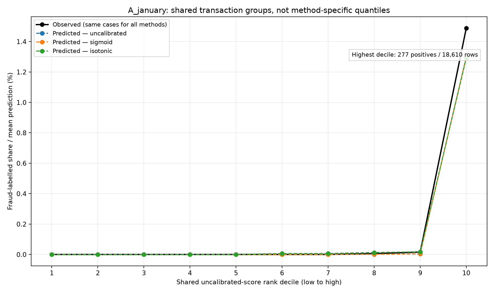
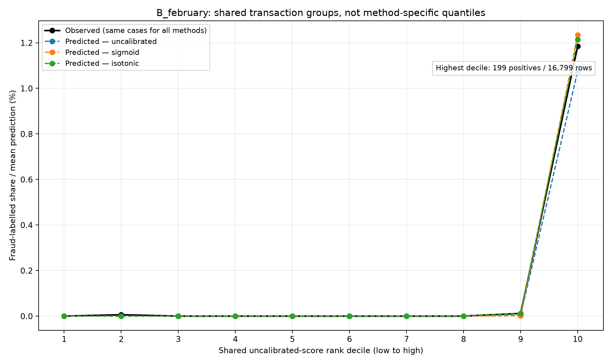
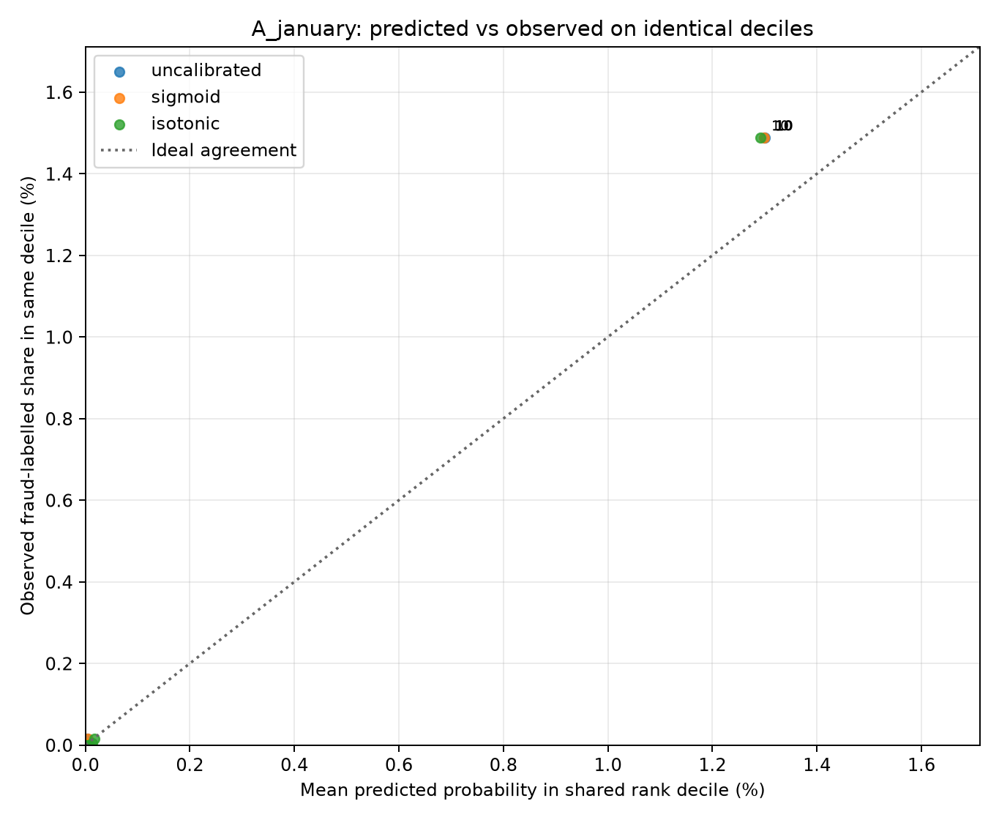
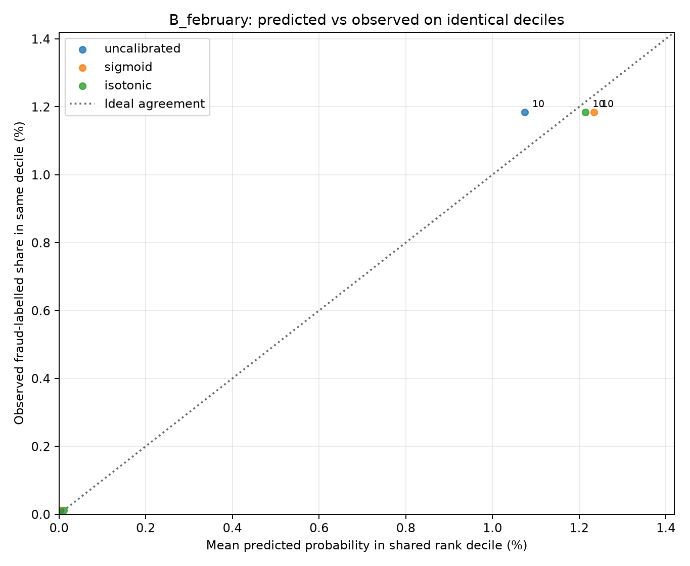

# What I found in the chronological calibration experiment

## Research question and the boundary I kept

I wanted to know whether the original log-amount logistic scores could be interpreted more reliably as probabilities, separately from their ability to rank transactions for review. I kept the original baseline and ablation runs unchanged. All fitted models and calibrators in this experiment used only October 2025 through January 2026 for fitting or calibration, and only January and February for reported evaluation. I did not score the reserved March–April holdout. February had already been explored in earlier work, so I do not call it an untouched final test.

My input is the same synthetic AMLNet v2 preparation. Row-level predictions, prepared data, six fitted joblib objects, and the unmodified v1/v2 run folders stay local and outside Git. These public figures and tables contain **aggregates only**. A GitHub reader cannot reproduce the saved-run audit from a clone alone without obtaining and preparing the dataset.

## Chronological design and model choices

In stage A, I fitted the 13-feature logistic log-amount pipeline on October–November (292,668 rows; 452 positives), fitted calibration mappings on December (190,055 rows; 198 positives), and selected a method using **January** (186,097 rows; 281 positives). The predeclared primary choice was January log loss, with Brier score used within a 1e-6 near-tie and a fixed simplicity order. The selected method was **isotonic regression**.

In stage B, I refitted the same base-model family on October–December (482,723 rows; 650 positives), fitted each calibration mapping on January, and reported their February performance (167,990 rows; 202 positives). I did not change the selection based on February. All three February calibration choices share the same stage-B base model; my original earlier full-feature logistic baseline used a *different training window*, so a comparison with that baseline does not isolate a calibration effect.

For a base score p = sigmoid(z), I compared: unchanged p, a monotone sigmoid mapping q = sigmoid(a logit(p) + b) with a >= 0, and isotonic regression with a nondecreasing fitted mapping f(p). The sigmoid calibrator minimizes calibration-period negative log likelihood subject to its slope constraint; isotonic minimizes squared error under its monotonicity constraint. Neither adds new information to the original feature representation. Monotonic transforms generally preserve ranking, but flat maps and clipping can create ties. The saved seeded label-independent tie order controls retrospective review selection.

## Actual numerical results

Lower values are better for log loss and Brier score. Recall describes top-1% review capture, not probability accuracy.

**Stage A — January method selection (1% reviews):**

| Method | Log loss | Brier | Average precision | Caught positives | False alerts | Recall |
|---|---:|---:|---:|---:|---:|---:|
| uncalibrated | 0.001470 | 0.000306 | 0.926641 | 271 | 1590 | 96.44% |
| sigmoid | 0.001486 | 0.000311 | 0.926641 | 271 | 1590 | 96.44% |
| isotonic | 0.001459 | 0.000301 | 0.918240 | 271 | 1590 | 96.44% |

Isotonic's January log-loss improvement over the uncalibrated model was **0.000011** in absolute units. This is a small observed difference, not evidence of statistical significance or robust superiority across months.

**Stage B — February historical comparison (1% reviews; not used for selection):**

| Method | Log loss | Brier | Average precision | Caught positives | False alerts | Recall |
|---|---:|---:|---:|---:|---:|---:|
| uncalibrated | 0.001086 | 0.000215 | 0.941444 | 197 | 1483 | 97.52% |
| sigmoid | 0.000993 | 0.000176 | 0.941444 | 197 | 1483 | 97.52% |
| isotonic | 0.001054 | 0.000179 | 0.934938 | 197 | 1483 | 97.52% |

Sigmoid had the lowest February log loss and Brier score, whereas January had selected isotonic. I will keep that method-selection result instead of changing it after inspecting February. This contrast suggests potential calibration sensitivity across historical windows; two evaluation months do not establish formal temporal drift. Isotonic also created score ties that lowered average precision relative to the two strictly ordered variants.

The original October–January baseline caught 196 of 202 February positive labels at 1,680 reviews. The new stage-B base model caught 197 of 202. I cannot attribute the one-case difference to calibration because the original baseline and stage-B model were fitted using different months.

## Corrected visual comparison

The original method-specific probability-quantile graphs had unequal bin counts: isotonic's ties produced four displayed groups in January and two in February, versus ten for the other methods. Those bin labels did not identify the same transactions. For publication, I fixed ten equal-count **uncalibrated-score rank deciles** and calculated each method's mean prediction on **exactly the same rows**. The saved label-independent priority handles rank ties at boundaries. Within a month, the black observed curve is now identical across methods.

- January's highest shared decile contained **277 positives / 18,610 rows**, observed rate **1.4884%**.
- February's highest shared decile contained **199 positives / 16,799 rows**, observed rate **1.1846%**.

I also plotted mean predicted rate against observed rate, with the ideal-agreement line. These are **aggregate decile summaries**, not evidence that individual scores are calibrated:

The high-risk decile dominates each linear-scale graph. Most lower bins contain zero or very few positive labels, so fine-grained conclusions about very small predicted probabilities are unsupported. In particular, the observed decile shares cannot be treated as the probability for every transaction inside that decile. The January and February deciles are constructed separately from each month's original scores, not identical transactions across months.

## Verification and mathematical limits

For binary labels y_i and probabilities p_i, Brier score is mean[(p_i-y_i)^2]; log loss is the negative mean of [y_i log(p_i)+(1-y_i)log(1-p_i)]. A lower value in one observed month describes that sample, not a guarantee of future calibration. Average precision and fixed-budget precision/recall concern ranking; they answer a different question. For fixed k, precision = TP/k and recall = TP/P, so all three methods can tie at the declared 1% budget even if their probability losses differ.

I reran the experiment in a new versioned v2 folder that saved **six fitted objects** (two base pipelines, two sigmoid mappings, two isotonic mappings). The local v2 verifier checked artifact SHA-256 digests before loading my own trusted joblib files, verified row identity and chronology, reconstructed saved probabilities and reported metrics, and confirmed that v2 reproduced v1 predictions and results. The full local test suite passed **124 tests** after the publication checks. This is a user-observed local audit, not an independent external rerun or GitHub CI certification.

For reproduction, see [my chronological protocol](calibration_temporal_protocol.md), [my saved-run verification notes](calibration_saved_run_verification.md) and [the corrected-bin explanation](calibration_visualization_revision.md). Aggregate values are in [the 1% results table](../results/tables/calibration_temporal_1pct_summary.csv) and [the shared-bin table](../results/tables/calibration_shared_reliability_bins.csv). The fitted objects, full prepared dataset, and row-level predictions remain excluded from the repository.

## Next unanswered questions

I still need forward-only stability checks beyond the two observed evaluations, uncertainty quantification appropriate for rare labels, a capacity-aware review rule that can operate without ranking an entire future month, and a frozen final assessment. Synthetic data, unusually strong category patterns, assumed decision-time feature availability, and already-explored February results limit any claim of real payment fraud performance or operational benefit. The reserved March–April holdout must stay unscored until those choices are fixed.
