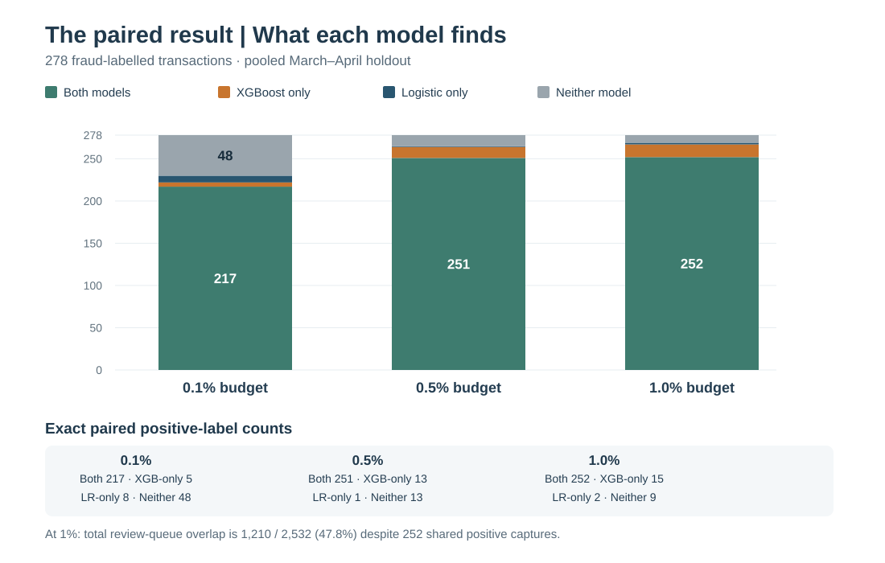
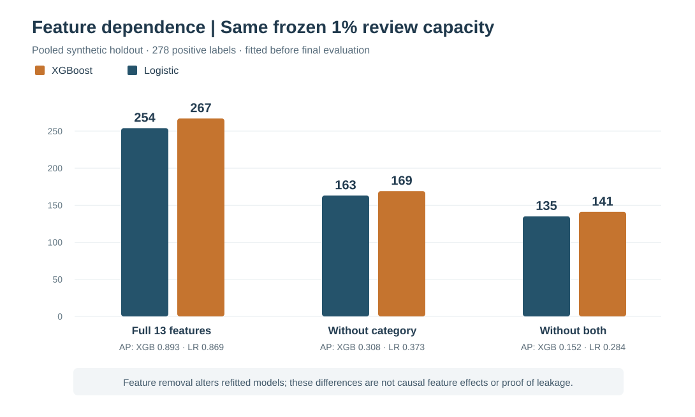

# Frozen final holdout — what the results actually say

**Status:** first completed March–April 2026 holdout evaluation of synthetic AMLNet v2; predeclared protocol followed; local read-only verification passed. This is the completed out-of-time evaluation, **not** evidence of production-ready fraud detection. I did not use these results to refit, retune, recalibrate or select another model.

My final protocol was committed before any model evaluation of these rows: [frozen methodology](final_holdout_frozen_protocol.md) and [machine-readable lock](../config/final_holdout_freeze_v1.json). An initial invocation opened and validated the held-out rows but stopped on a Python import error **before model predictions**; the interruption and the environment-only correction were documented in [execution instructions](final_holdout_execution.md). The first completed scored run used the same previously fitted models with `PYTHONPATH=src`. The locally saved `--verify-only` command reported **PASS: read-only saved hashes, lineage, paired counts and metrics; no model rescored**.

## 1. The decision I froze before seeing these model results

- **Primary candidate:** full-feature, uncalibrated XGBoost (`depth3_240`) fitted on October–December 2025; its configuration came from December development.
- **Required comparator:** full-feature, uncalibrated logistic regression fitted on the same historical period.
- **Single primary period and metric:** pooled **March–April 2026** test rows, top **1%** review capacity, comparing **positive labels captured by XGBoost minus positive labels captured by logistic**; a label-independent shared tie priority and ceiling rule fix the queues.
- **Predeclared secondary evidence:** 0.1% and 0.5% budgets; AP, Brier and log loss; already fitted sigmoid/isotonic maps; fixed category-removed and category-plus-type-removed refits; paired fraud-capture disagreements, total queue overlap, and separate monthly descriptions.
- **Forbidden:** choose a new model, feature set, calibration method or reporting rule based on this holdout.

The dataset has **253,190** test transactions, **278** positive labels (about **0.1098% prevalence**), and **2,532 reviews per model at 1%**. The overall class imbalance is why conventional accuracy would be uninformative here.

## 2. Primary result: XGBoost led at the frozen 1% budget

| Measure | Frozen XGBoost | Frozen logistic |
| --- | ---: | ---: |
| Review workload | 2,532 | 2,532 |
| Positive labels captured | **267** | 254 |
| Positive labels missed | 11 | 24 |
| Negative-labelled transactions reviewed | 2,265 | 2,278 |
| Precision among reviewed rows | **10.55%** | 10.03% |
| Recall of 278 positive labels | **96.04%** | 91.37% |
| Average precision over the whole ranking | **0.893416** | 0.868585 |
| Log loss on uncalibrated probabilities | **0.001289** | 0.001583 |
| Brier score on uncalibrated probabilities | **0.000261** | 0.000284 |

**Frozen primary comparison:** `267 - 254 = +13` additional positive-labelled transactions captured by XGBoost, a **4.68 percentage-point** difference in recall. This is an observed paired improvement under the chosen operational capacity on this *synthetic* holdout, not evidence that every deployment or cost setting favours XGBoost.

## 3. The smaller review budget tells a different story

| Predeclared pooled review capacity | Reviews/model | XGBoost capture | Logistic capture | Difference (XGB − LR) |
| --- | ---: | ---: | ---: | ---: |
| **0.1%** | 254 | 222 | **225** | **−3** |
| **0.5%** | 1,266 | **264** | 252 | +12 |
| **1.0% — primary** | 2,532 | **267** | 254 | **+13** |

At **0.1%** of transactions sent for review, logistic regression finds three more positives. At the frozen **1%** budget, XGBoost finds thirteen more. The winner is therefore **budget-dependent**; changing the objective after seeing results would overstate our finding.

AP is a whole-ranking summary, not a replacement for a constrained review queue. For the full, raw models it favours XGBoost, but other comparisons below do not always agree.

## 4. The models find many of the same fraud labels but queue different transactions

At the pooled primary 1% budget, the 278 positive labels separate as follows:

| Outcome for a positive-labelled transaction | Number |
| --- | ---: |
| Captured by **both** models | 252 |
| Captured **only by XGBoost** | 15 |
| Captured **only by logistic** | 2 |
| Captured by **neither** | 9 |
| **Total** | **278** |

The paired difference is therefore `15 - 2 = +13`; this agrees with the primary metric. But the **complete 2,532-transaction review lists overlap on only 1,210 rows (47.79%)**. Each model selects **1,322** transactions the other does not. Sharing most *caught positives* does not mean the two review queues are operationally interchangeable.

The predeclared smaller budgets also matter: at 0.1%, both catch 217 positives, XGBoost alone 5, logistic alone 8, neither 48; at 0.5%, both catch 251, XGBoost alone 13, logistic alone 1, neither 13. The exact queue overlaps are in [paired_overlap.csv](../results/tables/final_holdout_v1/paired_overlap.csv).

## 5. Synthetic category dependence is the central limitation

Both families were previously refitted on October–December with the same feature-removal definitions, **without new tuning or test-period fitting**. Applying those already fitted ablation models to the pooled holdout gives:

| Source features retained | XGBoost: positives at 1% | Logistic: positives at 1% | XGBoost AP | Logistic AP |
| --- | ---: | ---: | ---: | ---: |
| Full 13 | **267** | 254 | **0.893416** | 0.868585 |
| Without `category` | 169 | 163 | 0.308077 | **0.372815** |
| Without `category` and `type` | 141 | 135 | 0.152157 | **0.283650** |

The feature removal reduces XGBoost's captured positives by **98** without category and by **126** without both; the corresponding logistic drops are **91** and **119**. XGBoost still captures somewhat more positives at 1%, whereas logistic regression has **higher whole-ranking AP in both reduced-feature variants**. The chosen performance measure matters, especially when synthetic high-signal categorical fields are unavailable.

These are *refitted model sensitivity contrasts*, not the causal effects of individual columns. Earlier training SQL showed strong and sometimes deterministic category–label relationships; the existing [feature policy](../results/tables/amlnet_v2_initial_model_feature_policy.csv) treated `category` and `type` as provisional decision-time information. Their real-world source generation and pre-authorization availability remain **unverified**. A high holdout score within the same synthetic generator does not resolve that concern.

## 6. Calibration: do not select a post-hoc winner

The pre-fitted mappings change probability diagnostics, not the frozen primary raw-score decision.

| Frozen full-feature score series | AP | Log loss (lower better) | Brier (lower better) | Positive captures at 1% |
| --- | ---: | ---: | ---: | ---: |
| XGBoost raw | 0.893416 | 0.001289 | **0.000261** | 267 |
| XGBoost sigmoid | 0.893416 | **0.001240** | 0.000263 | 267 |
| XGBoost isotonic | 0.869510 | 0.001675 | 0.000264 | 267 |
| Logistic raw | 0.868585 | **0.001583** | 0.000284 | 254 |
| Logistic sigmoid | 0.868585 | 0.001595 | **0.000268** | 254 |
| Logistic isotonic | 0.857427 | 0.001854 | 0.000275 | 255 |

Within the XGBoost family, sigmoid improves **log loss** slightly relative to raw scores but does not improve **Brier score**. Within logistic, sigmoid improves Brier but slightly worsens log loss. Isotonic introduces score ties that can change ranking measures and fixed-capacity membership. These differences reinforce why a calibration choice must be justified by the **development** protocol and the intended decision use, rather than selected from the final holdout.

The absolute loss numbers are small partly because positive labels are rare; they should be read alongside capture/precision, prevalence and uncertainty.

## 7. Separate March and partial April results

For the predeclared **month-specific 1% of that month's population** budget:

| Period | Transactions | Positives | Reviews/model | XGBoost caught | Logistic caught |
| --- | ---: | ---: | ---: | ---: | ---: |
| March 2026 | 186,045 | 224 | 1,861 | **213** | 203 |
| April 2026 (partial) | 67,145 | 54 | 672 | **54** | 52 |

March recall is **95.09%** for XGBoost versus **90.63%** for logistic. April recall is **100%** versus **96.30%**, but April contains only 54 positive labels and is partial.

**Do not add the monthly figures to reconstruct the primary pooled result.** Each month has a *separately recomputed* tie priority and ranking cutoff; the two monthly review counts add to **2,533**, while the pooled primary budget is **2,532**. The logistic monthly captures add to 255, **not** the pooled logistic count of 254. The pooled result is the sole primary comparison; month-wise results are descriptive.

## 8. Reproducibility and publication boundary

The first completed scoring run used [the frozen evaluator](../scripts/evaluate_frozen_holdout.py) against the private saved, checksum-verified model artifacts and prepared dataset. The prior local test checkpoint was **184 passed**; the final local read-only verification reconciled saved row identities, result files, metric calculations and hash lineage **without recomputing predictions**. I have additionally reconciled the user-provided five-file aggregate ZIP: all **42 metric rows**, **9 paired-overlap rows**, primary counts, ceiling review budgets and confusion matrices were internally consistent. The two original uploaded PNGs visually matched the tables. The public SVG charts above are fresh *aggregate-only visualizations*, not altered predictions.

Public source tables have been copied **byte-for-byte** from the verified aggregate package:
- [All 42 metrics](../results/tables/final_holdout_v1/metrics.csv)
- [All 9 paired review overlaps](../results/tables/final_holdout_v1/paired_overlap.csv)
- [Frozen primary summary](../results/tables/final_holdout_v1/primary_summary.json)

The supplied aggregate ZIP had SHA-256 `b9b460c3ec870b175419cb26573caa8f9a72617aed208a3472943d4ed0e770cb`; its three numeric files separately had SHA-256 values `540ad8c54083a0a784f1681f1d0c0fc382f5d6ef5fb01dcd10af1600596aa0ca`, `bf7a2821b855be595803fc9b7d65c27b1d2f5de051aa329092099cdd20275ff7` and `6d2abb6c7f792522a9d29e96d0037fbc137bd1d0a0c3f868bf404a1e478c0b0c` for metrics, paired overlaps and summary, respectively.

Neither transaction-level predictions, raw/prepared Parquet files nor fitted `joblib` objects belong in Git. This public report and its arithmetic audit can support reproducible discussion, but **independent model-score reproduction** still requires running the frozen code with the separately downloaded data and locally generated, integrity-checked historical models.

## 9. Final interpretation

**Within the frozen 1% review decision on synthetic AMLNet v2, full-feature XGBoost captured 13 more positive labels than the same-window logistic benchmark.** The advantage did not extend to the smallest review budget, and category-free ranking quality favoured logistic regression on AP. The two models also produced substantially different review queues. These conditions and the unverified synthetic category provenance are essential parts of the result, not qualifications to omit for an impressive accuracy claim.

I did not run another experiment to manufacture a stronger result. The remaining work is public audit, project documentation, responsible comparison and PR review—not tuning the finished holdout.
