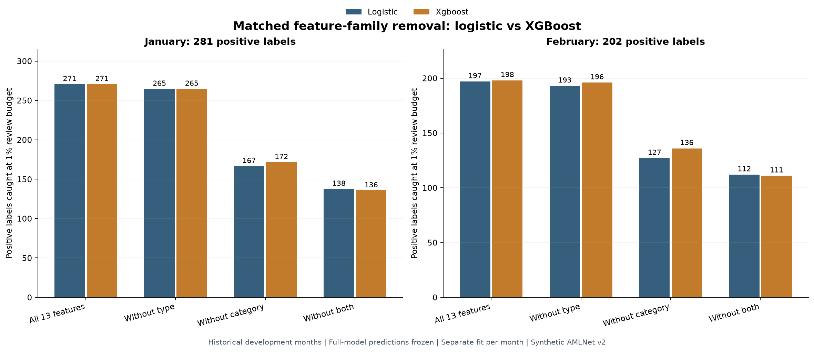
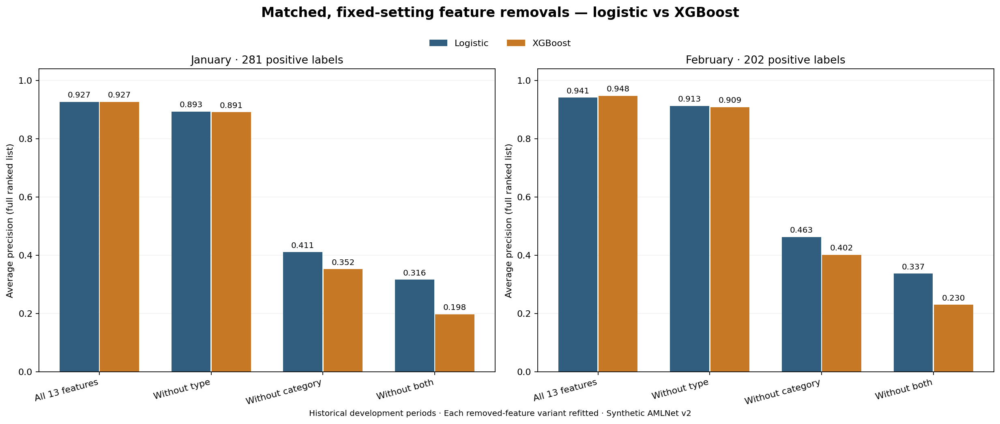

# What I learned from the matched XGBoost feature-removal study

**Status:** January–February 2026 historical development evidence on synthetic AMLNet v2. This is not a final holdout result or evidence of deployment suitability. I generated the model predictions and artifact reconstruction on my Mac; the public evidence here consists of aggregate tables and charts, not transaction-level scores or fitted objects.

## Question and experimental control

The full logistic and XGBoost comparisons suggested that category and transaction type may contain much of the available synthetic ranking signal. Instead of concluding from one model's split-gain plot, I removed each source-feature group and **refitted both model families** under a matched chronological design:

- **January:** October–November 2025 fitting, January 2026 historical evaluation, December used earlier for the fixed XGBoost configuration choice.
- **February:** October–December 2025 fitting, February 2026 historical evaluation. January was a separate calibration period in the earlier full-model study; this feature-removal experiment compares **uncalibrated rankings**.
- The four fixed configurations are full 13 features, without `type` (12), without `category` (12) and without both (11). I did **not** retune XGBoost hyperparameters for the reduced-feature variants: the December-selected depth-three, 240-tree configuration remains fixed. This is a controlled feature-removal sensitivity study, not an optimized search for each reduced set.
- Every compared model sees the same historical evaluation rows, uses the same label-independent tie priority and is evaluated at 0.1%, 0.5% and 1% review capacity. The script verifies the saved full-model references and the newly fitted artifacts. The final March–April holdout was not scored.

The local experiment passed **161 tests** and its read-only verification reported agreement among saved objects, row identities, 48 metric records and file hashes. The accompanying public aggregate review independently reconciles those 48 reported metric rows and all recorded deltas, but cannot reconstruct fitted models without the private local files.

## Results at 1% review capacity

January contains **186,097** transactions and **281** positive labels; the fixed 1% budget selects **1,861** reviews. February contains **167,990** transactions and **202** positive labels; the budget selects **1,680**.

| Retained source-feature set | January: logistic | January: XGBoost | February: logistic | February: XGBoost |
| --- | ---: | ---: | ---: | ---: |
| All 13 | 271 | 271 | 197 | 198 |
| Without `type` | 265 | 265 | 193 | 196 |
| Without `category` | 167 | 172 | 127 | 136 |
| Without both | 138 | 136 | 112 | 111 |

These are **positive labels found**, not accuracy or total correct decisions. Even at the February 1% budget, the full models sent **1,483** (logistic) and **1,482** (XGBoost) negative-labelled transactions for review.

### Category dependence is much larger than type dependence

Removing `category` decreased full-model captured positives by **104** for January logistic, **99** for January XGBoost, **70** for February logistic and **62** for February XGBoost. In comparison, removing `type` alone reduced the same four counts by 6, 6, 4 and 2. The observed dependence is substantial within these historical synthetic data. Feature removal changes the fitted model and its interactions, so the drop is a **refitting sensitivity**, not the causal effect of one variable and not proof that the field leaks the label.

## The average precision result complicates the ranking

Average precision (AP) evaluates the ordering over the **entire ranked list** rather than one chosen review cutoff. It need not agree with positive labels captured at the 1% cutoff.

| Configuration | January logistic AP | January XGBoost AP | February logistic AP | February XGBoost AP |
| --- | ---: | ---: | ---: | ---: |
| All 13 | 0.926641 | 0.927030 | 0.941444 | 0.947867 |
| Without `type` | 0.893226 | 0.891338 | 0.913022 | 0.908853 |
| Without `category` | 0.410759 | 0.352363 | 0.462588 | 0.401537 |
| Without both | 0.316101 | 0.197571 | 0.337223 | 0.229938 |

For example, without `category` in February, XGBoost catches **136** positive labels at 1%, compared with logistic's **127**, while logistic AP is **0.462588**, compared with XGBoost AP **0.401537**. I cannot call one family uniformly better under both objectives. If this research prioritizes the operational 1% review capacity, I must state that explicitly **before** final evaluation and report AP as a secondary ranking measure.

For ranked positions at which precision changes, the average-precision calculation is:

\[
\mathrm{AP}=\sum_j (R_j-R_{j-1})P_j, \qquad
\mathrm{Recall@}k=\frac{\mathrm{TP@}k}{\text{number of positive labels}}.
\]

The change relative to the refitted full-feature reference for the same month, model family and review budget is:

\[
\Delta\mathrm{TP}_{m,f,v,b}=\mathrm{TP}_{m,f,v,b}-\mathrm{TP}_{m,f,\mathrm{full},b}.
\]

## Reconciling my previous logistic feature-ablation study

The earlier baseline [feature-ablation results](feature_ablation_results.md) reported **130** positive labels at the February 1% budget for an October–January log-amount logistic fit without category. The new matched family comparison reports **127**, but the model was fitted on **October–December**. These are two different fitted training windows and therefore should not be quoted as a direct like-for-like performance change or treated as an arithmetic contradiction.

## What I can and cannot conclude

1. The full XGBoost model has a **small observed historical advantage** on some February measures, but neither January nor February is an untouched final test, and I have not established statistical superiority or temporal stability.
2. Removing `category` greatly weakens both families, and removing both strong categorical groups weakens them further. That is not proof of leakage. The current source-feature policy treats `category` and `type` as **conditional decision-time candidates**, and [data preparation](data_preparation.md) previously identified deterministic or nearly deterministic synthetic label patterns in some groups.
3. Before declaring a final model specification, I need a **feature-provenance and decision-time validity decision**: where do these fields come from, are their values established before review/authorization, and could the simulator have encoded a label-generating rule directly into them? Inspecting *generation documentation* and earlier training-period evidence is valid; choosing based on March–April outcomes is not.
4. The existing XGBoost average split-gain summary is descriptive and should not be interpreted as a causal contribution or proportional total gain.
5. Since hyperparameters were locked from December in the **full** model, the removed-feature XGBoost fits are controlled sensitivity comparisons, not necessarily their best possible tuned configurations. This deliberately limits how much I can infer from a reduced-feature failure.

**Proposed decision rule before opening the holdout:** Specify a primary fixed-capacity review metric, record eligible decision-time features, fix a single primary model and calibration/score policy using historical months only, and predeclare one reference comparator and a category-excluded sensitivity analysis. Treat any other holdout checks as descriptive, not occasions for retraining or posthoc winner selection. The final March–April evaluation must be run only once after these decisions are committed.

## Public verification and references

- [48 metrics at three review budgets](../results/tables/xgboost_benchmark_v1/feature_ablation_metrics.csv)
- [Recorded deltas relative to the corresponding full model](../results/tables/xgboost_benchmark_v1/feature_ablation_changes_vs_full.csv)
- [Original XGBoost protocol](xgboost_chronological_protocol.md), [ablation protocol](xgboost_feature_ablation_protocol.md), [historical matched results](xgboost_first_aggregate_results.md)
- [Original feature policy](../results/tables/amlnet_v2_initial_model_feature_policy.csv) and [data workspace](data_workspace.md)
- Chen & Guestrin (2016), *XGBoost: A Scalable Tree Boosting System*: https://arxiv.org/abs/1603.02754
- scikit-learn, *Precision-recall* / average precision: https://scikit-learn.org/stable/modules/model_evaluation.html#precision-recall-f-measure-metrics

I publish only aggregate tables, figures and auditable scripts here. Local Parquet score files and trusted fitted objects remain ignored by Git.
