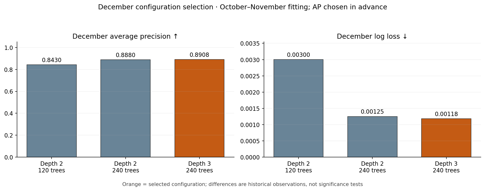
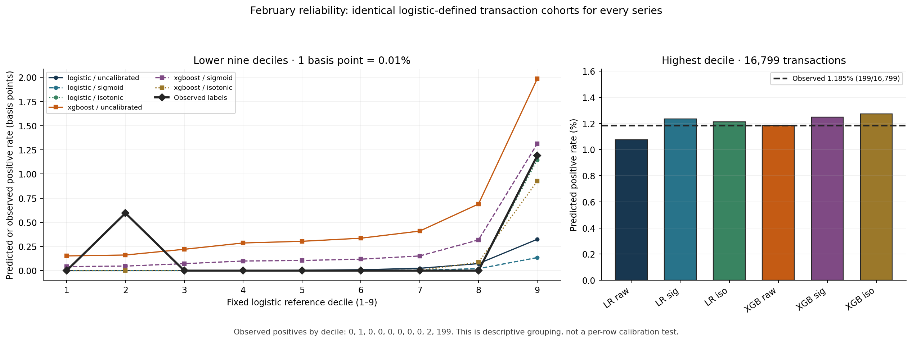

# What I learned from the first XGBoost benchmark

**Status: locally observed and aggregate-audited development results, not a final model choice.** I ran the new code on the same synthetic AMLNet v2 preparation as my saved logistic-regression study. The separate XGBoost run passed nine implementation tests, and the full local suite passed 133 tests before this results-review extension. The local `--verify-only` command confirmed artifact digests, fitted-object score reconstruction, transaction alignment and metrics. I independently checked the *four exported aggregate CSVs* for count/metric arithmetic and consistency with their five graphs. I have **not** independently rerun model fitting from the raw data outside my Mac, and I have **not** accessed March–April for training, tuning, scoring or model comparison.

## My experimental question

I already had a logistic baseline with meaningful synthetic ranking results. I wanted to ask whether a **different model family**, not merely a new calibration map, learned useful nonlinear interactions from the same 13 features. I therefore retained the prior logistic results rather than rewriting or replacing them. XGBoost was my first bounded nonlinear control, not an assertion that a more complex model must win.

These results involve distinct periods:

| Stage | Fitting / selection / calibration | Evaluation | Status |
|---|---|---|---|
| XGBoost configuration search | Fit Oct–Nov 2025, compare exactly three configurations on December average precision | December | Development selection |
| January family comparison | Fit Oct–Nov with the December-chosen configuration and the fixed logistic specification | January | Previously explored historical month |
| February family comparison | Fit both families Oct–Dec, fit *each* calibration mapping on January scores; reuse the locally verified frozen logistic Stage-B outputs | February | Historical comparison; not an untouched test |
| Final reserved holdout | No fit, score or selection | March–April | **Untouched by this experiment** |

My original 13 input features and the preprocessing design were unchanged. The transformed feature matrix was learned on the stage-specific fitting months. December was the only XGBoost hyperparameter-selection month. Neither January nor February changed the three candidate choices.

## Why these models differ mathematically

For input vector \(x\), the logistic baseline has log odds linear in its transformed features:

\[p_{LR}(y=1\mid x)=\sigma(\beta_0+\beta^\top x), \quad \sigma(z)=1/(1+e^{-z}).\]

XGBoost adds trees sequentially to its logit score:

\[F_T(x)=F_0(x)+\eta\sum_{t=1}^T f_t(x), \qquad p_{XGB}(y=1\mid x)=\sigma(F_T(x)).\]

It approximately minimizes the binary logistic loss plus tree complexity penalties:

\[\mathcal L =\sum_{i=1}^n \ell(y_i,F_T(x_i)) + \sum_{t=1}^T\left(\gamma L_t + \frac{\lambda}{2}\sum_{j=1}^{L_t} w_{tj}^2\right).\]

With second-order gradient and Hessian sums \(G,H\), the regularized leaf update is \(w^*=-G/(H+\lambda)\). A split is chosen using the improvement

\[\mathrm{Gain}=\frac12\left(\frac{G_L^2}{H_L+\lambda}+\frac{G_R^2}{H_R+\lambda}-\frac{(G_L+G_R)^2}{H_L+H_R+\lambda}\right)-\gamma.\]

This permits feature interactions not explicitly present in the logistic design. But with such rare labels in synthetic data, extra flexibility can also model dataset-specific shortcuts. My fixed candidates used `max_depth` of 2 or 3, 120 or 240 trees, learning rate 0.05, and no reweighting or oversampling; the search is deliberately small. Source: Chen & Guestrin (2016), cited below.

## December: select configuration without consulting February

| Candidate | Max depth | Trees | December AP | December log loss |
|---|---:|---:|---:|---:|
| `depth2_120` | 2 | 120 | 0.842992 | 0.003005 |
| `depth2_240` | 2 | 240 | 0.887980 | 0.001251 |
| **`depth3_240`** | **3** | **240** | **0.890792** | **0.001184** |

The locked selection rule maximized December average precision; AP values within `1e-6` could be separated by log loss and then fixed order. This selected **`depth3_240`**, exceeding `depth2_240` by about **0.002812 AP**. I do **not** treat December as an independent estimate of the winning configuration's generalization; I used its labels to choose that configuration.

Average precision is a weighted sum over recall increases, \(\mathrm{AP}=\sum_k (R_k-R_{k-1})P_k\); I used it because the class was rare and I cared about ranking fraud-labelled transactions near the top. The fixed monthly review counts follow \(K=\lceil qN\rceil\), with \(\mathrm{Precision@K}=TP_K/K\) and \(\mathrm{Recall@K}=TP_K/P\).

## January: same fitting window, nearly tied rankings

Both families fitted October–November. On January's **186,097** transactions with **281** positive labels, logistic AP was **0.926641** and XGBoost AP **0.927030**. At the 1% retrospective review budget (**1,861** cases), both caught **271** positives and generated **1,590** false alerts. At 0.1% (187 reviews), both caught 187 positives; at 0.5% (931 reviews), logistic caught 266 and XGBoost 267.

A difference in AP of **0.000389** is an observed historical difference, not evidence that the nonlinear model is substantially better. January had already been explored in my prior calibration work, so I do not call this a new held-out result.

## February: matched periods but no fresh holdout

Both model families fitted October–December and were compared on the same **167,990 February transactions with 202 positive labels**. The logistic probabilities came from the existing **frozen Stage-B experiment**. Calibration mappings for each family were fitted on January outputs, not February. For fair comparison, I kept the source rows and seeded label-independent tie order aligned.

| February model | AP | Log loss ↓ | Brier ↓ | Positive labels caught at 1% | False alerts at 1% |
|---|---:|---:|---:|---:|---:|
| Logistic raw | 0.941444 | 0.001086 | 0.000215 | 197 | 1,483 |
| Logistic sigmoid | 0.941444 | 0.000993 | 0.000176 | 197 | 1,483 |
| Logistic isotonic | 0.934938 | 0.001054 | 0.000179 | 197 | 1,483 |
| XGBoost raw | **0.947867** | 0.000888 | 0.000176 | **198** | **1,482** |
| XGBoost sigmoid | **0.947867** | 0.000833 | 0.000180 | **198** | **1,482** |
| XGBoost isotonic | 0.935069 | **0.000805** | 0.000179 | **198** | **1,482** |

The uncalibrated XGBoost model's AP was higher by **0.006423** and caught **one additional positive label at 1% reviews**. At smaller budgets, the original uncalibrated models differed more:

| Fraction | Reviews | Logistic positives caught | XGBoost positives caught | XGBoost-minus-logistic |
|---|---:|---:|---:|---:|
| 0.1% | 168 | 165 | 168 | +3 |
| 0.5% | 840 | 194 | 197 | +3 |
| 1.0% | 1,680 | 197 | 198 | +1 |

At 0.1%, the XGBoost top 168 scores were all positive-labelled transactions, an unusually strong result to interrogate on synthetic data. The near-tie in Brier score between logistic sigmoid and XGBoost raw is hidden when values are rounded to six decimal places, and the calibrated XGBoost variants do **not** all have lower Brier scores than the logistic sigmoid model.

Log loss and Brier score assess probabilities; AP and review-budget capture assess ranking. Isotonic created ties—its XGBoost AP (0.935069) is below XGBoost's raw AP (0.947867) despite its lowest February log loss. February should **not** be used to reselect the calibrator and then described as untouched testing. I have not yet committed to an XGBoost calibration method based on a separate, predefined method-selection rule.

## Shared-bin reliability: what the graph means

I used ten equal-size cohorts defined by the **frozen raw logistic ranking**, not ten separately computed XGBoost deciles. Every method's observed points are therefore calculated on identical transaction sets. Each bin contains **16,799** transactions; the observed February positive counts by increasing reference decile are **0, 1, 0, 0, 0, 0, 0, 0, 2, 199**. The highest reference cohort has observed rate **199/16,799 = 1.1846%**.

For that same highest cohort, mean predicted rates are: logistic raw **1.0749%**, logistic sigmoid **1.2346%**, logistic isotonic **1.2140%**, XGBoost raw **1.1858%**, XGBoost sigmoid **1.2495%**, and XGBoost isotonic **1.2729%**. The large top-bin rates compress the first nine bins on a linear-scale plot, so my revised visualization puts the first nine in **basis points (0.01% per basis point)** and the highest bin in a separate percentage panel. A bin mean matching its observed rate does not prove that each individual prediction is calibrated.

## What the XGBoost feature-gain results do — and do not — show

The generated table reports normalized `XGBClassifier.feature_importances_` values with `importance_type='gain'`, **summed across encoded columns** belonging to each original feature group. `gain` is average objective improvement for splits using an encoded feature, not `total_gain` (the sum of all split improvements) and not a causal or permutation effect.

| Source feature group | Sum of normalized encoded-feature gains |
|---|---:|
| `category` | **66.6365%** |
| `type` | **17.4093%** |
| `amount` | 6.0232% |
| All ten remaining groups combined | 9.9310% |

`category` plus `type` represent **84.0459%** of this particular normalized gain summary. This justifies a new **ablation and decision-time availability audit**, not a claim that category explains 66.6% of fraud or that it is necessarily leakage. One-hot grouping may also alter the relative weight of categorical versus numeric source features; a separate grouped permutation-importance analysis would test a different question. The dataset is entirely synthetic and might contain category/label shortcuts that do not generalize.

## What I cannot conclude yet

- The aggregate CSVs reproduce all 24 review-budget accounting rows and 60 same-cohort bin rows, but do **not** permit a row-level **paired disagreement analysis**. Counts of 197 versus 198 do not tell me whether XGBoost found all of logistic's 197 cases.
- A gain of one positive at 1% reviews does not establish statistically meaningful superiority. I need paired confidence analysis mindful of temporal dependence and low event counts.
- The monthly top-K result ranks an **entire completed month** retrospectively. It does not demonstrate a deployable transaction-time review policy or quantify real savings.
- Decision-time feature availability is assumed from the prepared data, not independently validated. No evidence about real-world fraud performance follows from synthetic AMLNet v2.
- February has been investigated repeatedly in this project, so these are development results. **March–April remains the reserved, unscored final holdout.**

## Reproduction, evidence and publication boundary

I kept the original local `models/xgboost_benchmark_v1/` artifacts untouched. The published *candidate* review tables are only four aggregates: `december_candidates.csv`, `metrics.csv`, `february_shared_cohort_bins.csv`, and `stage_b_feature_importance.csv`. A separate aggregate-only plotting script validates fixed window names, selected counts, confusion matrix accounting, source-feature totals and same-cohort bins, then renders five accessible figures and a SHA-256 manifest. It loads no raw data, individual predictions or fitted models. The full-data verifier in `payment_guard.xgboost_chronological` provides distinct, locally observed fitted-model reconstruction evidence. These two verification layers should not be confused.

**Next experiment:** Before selecting a final model, compare `category`/`type` ablations for both model families under the same chronological boundaries, compute **paired top-K disagreement** from saved local row-level predictions, estimate uncertainty appropriate for temporal structure, and design a review policy with decision-time capacity. This work must finish and be frozen before the March–April holdout is used even once.

## References

1. Chen, T., & Guestrin, C. (2016). *XGBoost: A Scalable Tree Boosting System*. Proceedings of KDD 2016. https://doi.org/10.1145/2939672.2939785 ; manuscript https://arxiv.org/abs/1603.02754 . Gradient boosting, split gain, regularization and tree construction.
2. XGBoost maintainers. *Parameters*. https://xgboost.readthedocs.io/en/stable/parameter.html . Model and optimization settings.
3. XGBoost maintainers. *Python API Reference*, feature importance `gain` versus `total_gain`. https://xgboost.readthedocs.io/en/stable/python/python_api.html . Definitions used for interpreting the feature-importance figure.
4. scikit-learn developers. *Precision, Recall, F-measure and Average Precision*. https://scikit-learn.org/stable/modules/model_evaluation.html#precision-recall-f-measure-metrics . Ranking metrics and non-interpolated average precision.
5. scikit-learn developers. *Probability Calibration*. https://scikit-learn.org/stable/modules/calibration.html . Sigmoid versus isotonic, calibration and ties.

The references justify my **methods**, not these dataset-specific numerical results; all displayed numbers originate from my saved development aggregates.
